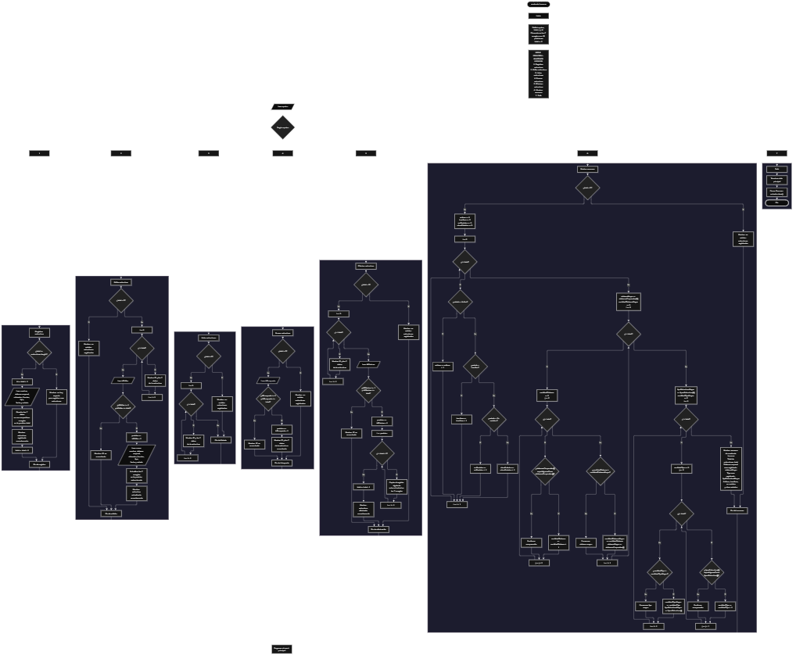

Este proyecto, llamado <b>Anatomía Humana</b>, fue desarrollado en <b>Java</b> como un ejercicio práctico para fortalecer la lógica de programación mediante la creación de un sistema de gestión de estructuras anatómicas desde la consola. El programa cuenta con un menú principal de siete opciones que permite <b>registrar, editar, listar, buscar, eliminar y consultar un resumen</b> de las estructuras anatómicas almacenadas. Cada estructura contiene información como el nombre, el sistema corporal, la ubicación, la función, el tipo de estructura, la fecha de registro y su estado, utilizando siete arreglos paralelos con una capacidad máxima de <b>10 estructuras durante la ejecución</b>. Durante su desarrollo se aplicaron conceptos fundamentales de programación, como variables, arreglos, estructuras condicionales, ciclos repetitivos y estructuras de selección, además de procesos para buscar, modificar, eliminar y organizar registros. Este proyecto permite poner en práctica los conocimientos adquiridos en Java y sirve como base para desarrollar sistemas de gestión más avanzados utilizando otros lenguajes y tecnologías.

<h2 align="center">⚙️ Funcionamiento del menú principal</h2>

### ➕ Registrar estructura

La opción <b>1) registrar estructura</b> permite almacenar una nueva estructura anatómica en el sistema. Antes de realizar el registro, el programa comprueba que la cantidad de estructuras almacenadas sea menor que la capacidad máxima de los arreglos, utilizando la condición <b>total >= estructuras.length</b> para identificar si ya no existe espacio disponible. Si hay espacio, genera un identificador mediante la expresión <b>total + 1</b> y solicita el <b>nombre de la estructura, sistema corporal, ubicación, función, tipo de estructura, fecha de registro y estado del registro</b>. Los datos se almacenan en la posición correspondiente de sus respectivos arreglos. Finalmente, muestra el mensaje <b>"Estructura registrada correctamente."</b> y aumenta la variable <b>total</b> en uno. Si se alcanza la capacidad máxima, presenta el mensaje <b>"No hay espacio para registrar mas estructuras."</b>, impidiendo agregar otro registro.

### ✏️ Editar estructura

La opción <b>2) editar estructura</b> permite modificar la información de una estructura anatómica registrada. Primero, el programa comprueba si existen registros almacenados mediante la variable <b>total</b>. Si no hay estructuras registradas, muestra el mensaje <b>"No existen estructuras registradas."</b>. En caso contrario, utiliza un ciclo <b>for</b> para presentar una lista con el ID, nombre, sistema corporal, ubicación, función, tipo, fecha y estado de cada estructura. Después, solicita el ID de la estructura que se desea editar y comprueba que esté dentro del rango permitido mediante la condición <b>idEditar >= 1 && idEditar <= total</b>. Si la selección es válida, calcula su posición utilizando <b>idEditar - 1</b> y solicita los nuevos datos, actualizando directamente los valores de los siete arreglos correspondientes. Finalmente, presenta el mensaje <b>"Estructura actualizada correctamente."</b>. Si el ID seleccionado no corresponde a una estructura registrada, muestra el mensaje <b>"ID no encontrada."</b>.

### 📋 Listar estructuras

La opción <b>3) listar estructuras</b> permite visualizar todas las estructuras anatómicas registradas actualmente en el sistema. Antes de mostrar la información, el programa comprueba si la variable <b>total</b> es igual a cero. Si no existen registros, presenta el mensaje <b>"No existen estructuras registradas."</b>. Si hay estructuras disponibles, utiliza un ciclo <b>for</b> para recorrer los arreglos desde la primera posición hasta la cantidad total de registros almacenados. Durante el recorrido, muestra el ID, nombre de la estructura, sistema corporal, ubicación, función, tipo de estructura, fecha de registro y estado. Esta función facilita consultar todos los registros existentes sin necesidad de buscar cada estructura individualmente.

### 🔎 Buscar estructura

La opción <b>4) buscar estructura</b> permite localizar una estructura anatómica mediante su identificador. Primero, el programa comprueba si existen estructuras registradas. Si no hay información almacenada, muestra el mensaje <b>"No existen estructuras registradas."</b>. En caso contrario, solicita el ID de la estructura que se desea buscar y verifica que esté dentro del rango válido mediante la condición <b>idBusqueda >= 1 && idBusqueda <= total</b>. Si el ID es correcto, calcula la posición correspondiente utilizando <b>idBusqueda - 1</b> y muestra toda la información de la estructura encontrada: <b>nombre, sistema corporal, ubicación, función, tipo de estructura, fecha y estado</b>. Si el identificador introducido no corresponde a ningún registro existente, presenta el mensaje <b>"ID no encontrada."</b>. Esta operación utiliza el identificador para acceder directamente a la posición correspondiente de los arreglos, sin necesidad de recorrerlos mediante un ciclo de búsqueda.

### 🗑️ Eliminar estructura

La opción <b>5) eliminar estructura</b> permite eliminar una estructura anatómica registrada mediante su identificador. Antes de comenzar, el programa comprueba que existan estructuras almacenadas. Si no hay registros, muestra el mensaje <b>"No existen estructuras registradas."</b>. Si existen estructuras disponibles, presenta una lista con los datos de cada registro. Después, solicita el ID de la estructura que se desea eliminar y verifica que se encuentre dentro del rango permitido. Si el identificador es válido, calcula su posición mediante <b>idEliminar - 1</b> y comienza el proceso de eliminación. Para mantener los registros organizados, utiliza un ciclo <b>for</b> que desplaza una posición hacia atrás los datos posteriores en los siete arreglos: <b>estructuras, sistemasCorporales, ubicaciones, funciones, tiposEstructura, fechas y estados</b>. Posteriormente, disminuye la variable <b>total</b> en uno y muestra el mensaje <b>"Estructura eliminada correctamente."</b>. Si el ID seleccionado no corresponde a una estructura registrada, presenta el mensaje <b>"ID no encontrada."</b>.

### 📊 Mostrar resumen

La opción <b>6) mostrar resumen</b> permite consultar estadísticas generales sobre las estructuras anatómicas almacenadas. Primero, el programa comprueba si existen registros mediante la variable <b>total</b>. Si no hay estructuras registradas, muestra el mensaje <b>"No existen estructuras registradas."</b>. En caso contrario, inicializa cuatro variables contadoras: <b>activas, inactivas, enRevision y otrosEstados</b>. Después, utiliza un ciclo <b>for</b> para recorrer el arreglo <b>estados</b> y clasificar cada registro mediante estructuras condicionales. Las comparaciones se realizan con el método <b>equalsIgnoreCase()</b>, identificando los estados <b>"Activo", "Inactivo" y "En revision"</b>. Cualquier otro estado se contabiliza dentro de <b>otrosEstados</b>.

Posteriormente, el programa calcula el <b>sistema corporal más registrado</b> utilizando los arreglos <b>sistemasCorporales</b> y dos ciclos <b>for</b> anidados. El primer ciclo selecciona cada sistema corporal y el segundo cuenta cuántas veces aparece en el arreglo. Si la cantidad encontrada supera el máximo anterior, actualiza las variables <b>cantidadSistemaMayor</b> y <b>sistemaMayor</b>. El mismo procedimiento se aplica para identificar el <b>tipo de estructura más registrado</b>, utilizando los arreglos <b>tiposEstructura</b> y las variables <b>cantidadTipoMayor</b> y <b>tipoEstructuraMayor</b>. Finalmente, muestra el total de estructuras registradas, el sistema corporal más frecuente, el tipo de estructura más frecuente y las cantidades correspondientes a los diferentes estados.

### 🚪 Salir del menú principal

La opción <b>7) salir</b> está destinada a finalizar la ejecución del programa y muestra el mensaje <b>"Gracias por utilizar Anatomia Humana."</b>. El menú principal se encuentra dentro de una estructura repetitiva <b>do while</b>, que mantiene el programa en funcionamiento mientras la opción seleccionada sea diferente de <b>7</b>. Cuando el usuario selecciona esta opción, el mensaje de despedida aparece y la condición del ciclo permite finalizar el menú principal. Finalmente, se utiliza <b>entrada.close()</b> para cerrar el objeto <b>Scanner</b> y terminar la ejecución del programa.

<h2 align="center">🧠 Temas aplicados en el proyecto</h2>

### 📦 Variables

En este proyecto se utilizan variables para almacenar la opción seleccionada en el menú, controlar la cantidad de estructuras registradas, generar identificadores, recorrer los arreglos, seleccionar los registros que se desean editar, buscar o eliminar y calcular las estadísticas del resumen. Cada variable cumple una función específica dentro de las operaciones de gestión de estructuras anatómicas.

🔢 **Opcion:** Almacena la opción seleccionada por el usuario en el menú principal.

📊 **Total:** Almacena la cantidad actual de estructuras anatómicas registradas.

🆔 **Id:** Genera el identificador de una nueva estructura mediante la expresión `total + 1`.

🔄 **I:** Funciona como contador en los ciclos `for` y permite recorrer los arreglos y seleccionar posiciones durante las operaciones.

🔎 **IdEditar:** Almacena el identificador de la estructura que se desea modificar.

🔍 **IdBusqueda:** Almacena el identificador de la estructura que se desea consultar.

🗑️ **IdEliminar:** Almacena el identificador de la estructura que se desea eliminar.

📍 **Posicion:** Permite calcular el índice del arreglo correspondiente al identificador seleccionado, restándole uno.

📊 **Activas, Inactivas, EnRevision y OtrosEstados:** Almacenan las cantidades de estructuras clasificadas según su estado.

📈 **SistemaMayor y CantidadSistemaMayor:** Almacenan el sistema corporal que aparece con mayor frecuencia y su cantidad de apariciones.

📋 **TipoEstructuraMayor y CantidadTipoMayor:** Almacenan el tipo de estructura más registrado y su cantidad de apariciones.

### 🗃️ Arreglos

En este proyecto se utilizan siete arreglos relacionados con los datos de cada estructura anatómica. Cada arreglo tiene una capacidad de <b>10 posiciones</b> y utiliza el mismo índice para representar la información correspondiente a una misma estructura. Por ejemplo, los datos de una estructura almacenada en la posición <b>0</b> se encuentran distribuidos entre <b>estructuras[0], sistemasCorporales[0], ubicaciones[0], funciones[0], tiposEstructura[0], fechas[0] y estados[0]</b>. Esta organización permite recorrer, buscar, modificar, mostrar, eliminar y organizar los registros de manera ordenada.

🦴 **Estructuras[10]:** Almacena los nombres de las estructuras anatómicas registradas.

🫀 **SistemasCorporales[10]:** Almacena los sistemas corporales a los que pertenecen las estructuras.

📍 **Ubicaciones[10]:** Almacena las ubicaciones anatómicas de las estructuras.

⚙️ **Funciones[10]:** Almacena las funciones que desempeñan las estructuras anatómicas.

📋 **TiposEstructura[10]:** Almacena los tipos de estructuras anatómicas.

📅 **Fechas[10]:** Almacena las fechas de registro de las estructuras.

📊 **Estados[10]:** Almacena los estados correspondientes a cada registro.

### 🔀 Estructuras condicionales

En este proyecto se utilizan las estructuras <b>if, else if y else</b> para comprobar si existe espacio disponible antes de registrar una nueva estructura, verificar si existen registros antes de realizar determinadas operaciones, validar los identificadores seleccionados para editar, buscar o eliminar estructuras y clasificar los registros según su estado. También se utilizan condiciones para determinar cuál es el sistema corporal y el tipo de estructura que aparecen con mayor frecuencia. Estas condiciones permiten que el programa responda de manera diferente según la información almacenada y el resultado de cada operación.

### 🔄 Estructuras repetitivas

En este proyecto se utiliza el ciclo <b>for</b> para recorrer los arreglos, mostrar las estructuras registradas, reorganizar los datos durante la eliminación y realizar los cálculos estadísticos del resumen. También se utilizan ciclos <b>for</b> anidados para comparar los elementos de los arreglos <b>sistemasCorporales</b> y <b>tiposEstructura</b>, contando cuántas veces aparece cada valor. Por otro lado, el ciclo <b>do while</b> mantiene activo el menú principal y permite que el usuario realice diferentes operaciones hasta seleccionar la opción de salida.

### 🎯 Estructura switch

El programa utiliza la estructura <b>switch</b> para evaluar el valor almacenado en la variable <b>opcion</b> y ejecutar el bloque de instrucciones correspondiente. Cada caso representa una operación específica del sistema: <b>registrar, editar, listar, buscar, eliminar, mostrar resumen o salir</b>. También se utiliza el bloque <b>default</b> para mostrar el mensaje <b>"Opcion no valida."</b> cuando el usuario introduce un número que no coincide con ninguna de las opciones definidas en el menú principal.

### 🔢 Dimensionamiento de arreglos

El programa utiliza la creación de arreglos mediante la instrucción <b>new String[10]</b> para establecer la capacidad de almacenamiento de cada uno de los siete arreglos. Cada arreglo dispone de <b>10 posiciones</b>, lo que permite administrar hasta 10 estructuras anatómicas durante la ejecución. La cantidad de posiciones ocupadas se controla mediante la variable <b>total</b>, por lo que las operaciones recorren únicamente los registros comprendidos entre la primera posición y el total actual de estructuras almacenadas. Para comprobar la capacidad disponible, se utiliza la propiedad <b>estructuras.length</b>.

### 🔄 Reorganización de registros

Cuando se selecciona una estructura para eliminarla, el programa utiliza un ciclo <b>for</b> que comienza en la posición seleccionada y continúa hasta <b>total - 1</b>. En cada repetición, los datos de la posición siguiente se copian sobre la posición actual en los siete arreglos: <b>estructuras, sistemasCorporales, ubicaciones, funciones, tiposEstructura, fechas y estados</b>. Después, la variable <b>total</b> disminuye en uno. De esta manera, las estructuras posteriores ocupan las posiciones disponibles sin dejar espacios vacíos entre los registros activos. La última posición no se limpia explícitamente, pero queda fuera del conjunto de registros activos.

<h2 align="center">¿Cómo se implementaron las operaciones CRUD en el proyecto?</h2>

Las operaciones <b>CRUD</b> se implementaron mediante las opciones del menú principal, permitiendo administrar las estructuras anatómicas registradas. La operación <b>crear</b> corresponde a <b>registrar estructura</b>, donde se introducen los datos de una nueva estructura; <b>leer</b> se realiza mediante las opciones <b>buscar estructura y listar estructuras</b>, que permiten consultar la información almacenada; <b>actualizar</b> corresponde a <b>editar estructura</b>, donde se modifican los datos de una estructura registrada; y <b>eliminar</b> se realiza mediante la opción <b>eliminar estructura</b>. Adicionalmente, la opción <b>mostrar resumen</b> permite obtener estadísticas generales de los registros. Estas operaciones utilizan variables, arreglos, condicionales y ciclos para gestionar la información almacenada temporalmente durante la ejecución del programa.

<h2 align="center">Diagrama de flujo del proyecto</h2>

<h2 align="center">🛡️ Validaciones del programa</h2>

### 📭 No existen estructuras registradas

Esta validación se utiliza en las opciones de <b>editar, buscar, eliminar y mostrar resumen</b>. El programa comprueba si la variable <b>total</b> es igual a <b>0</b> y, si no existen estructuras registradas, muestra el mensaje <b>"No existen estructuras registradas."</b>. En la opción de listar también se comprueba esta condición para informar que no hay datos disponibles. Esta comprobación evita continuar con las operaciones que necesitan información almacenada cuando el sistema está vacío.

### ⚠️ Capacidad máxima alcanzada

Esta validación se utiliza durante el registro de nuevas estructuras para controlar la capacidad máxima de los arreglos. El programa comprueba si <b>total >= estructuras.length</b> antes de permitir agregar un nuevo registro. Si la cantidad de estructuras almacenadas es menor que la capacidad máxima, solicita los datos y aumenta el contador <b>total</b>. En caso contrario, muestra el mensaje <b>"No hay espacio para registrar mas estructuras."</b>, impidiendo registrar más estructuras mientras se mantenga la capacidad máxima.

### ❌ ID no encontrada

Esta validación se utiliza durante las operaciones de <b>editar, buscar y eliminar estructuras</b>. El programa comprueba que el identificador introducido sea mayor o igual a <b>1</b> y menor o igual al valor de <b>total</b>. Si el ID está dentro del rango permitido, calcula la posición correspondiente mediante <b>id - 1</b> y realiza la operación solicitada. Si el identificador no corresponde a una estructura registrada, presenta el mensaje <b>"ID no encontrada."</b>. Esta comprobación evita acceder a posiciones que no corresponden a registros activos.

### 🔢 Selección de estructuras

El programa utiliza las variables <b>idEditar, idBusqueda e idEliminar</b> para identificar la estructura que se desea modificar, consultar o eliminar. Antes de realizar estas operaciones, comprueba que el identificador introducido se encuentre dentro del rango comprendido entre <b>1</b> y el número total de estructuras registradas. Cuando la selección es válida, utiliza la variable <b>posicion</b> para acceder al índice correspondiente de los arreglos. Si la selección está fuera de ese rango, muestra el mensaje <b>"ID no encontrada."</b>.

### ⚠️ Opción inválida

La estructura <b>switch</b> incluye el bloque <b>default</b>, que muestra el mensaje <b>"Opcion no valida."</b> cuando el usuario introduce un número que no corresponde a ninguna de las siete opciones definidas en el menú principal. Esta validación permite informar al usuario que debe seleccionar una opción disponible para continuar utilizando el sistema.

<h2 align="center">🎯 Objetivo del proyecto</h2>

El objetivo principal de este proyecto es fortalecer la <b>lógica de programación</b> mediante el desarrollo de un sistema de gestión de estructuras anatómicas en <b>Java</b>. A través de su construcción se busca aplicar los conocimientos adquiridos sobre variables, arreglos, estructuras condicionales, ciclos repetitivos y estructuras de selección, integrándolos para resolver un problema de manera organizada. Además, el proyecto permite comprender cómo registrar, consultar, modificar y eliminar información en una aplicación de consola, así como realizar cálculos estadísticos a partir de los datos almacenados, estableciendo una base para desarrollar sistemas de gestión más completos con otros lenguajes y tecnologías.

